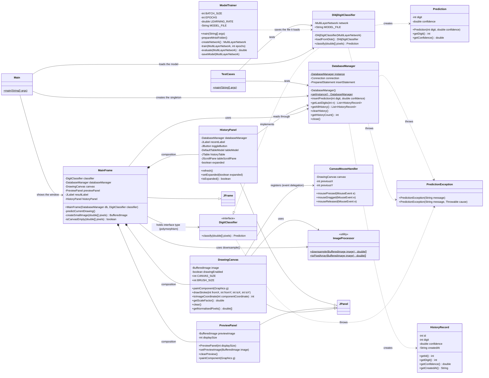
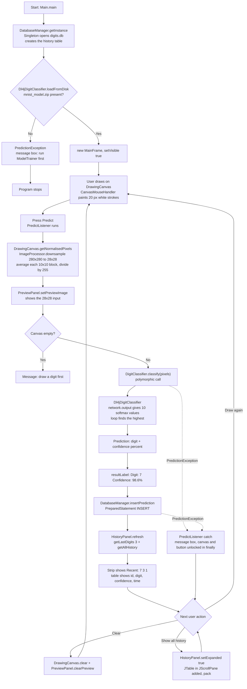
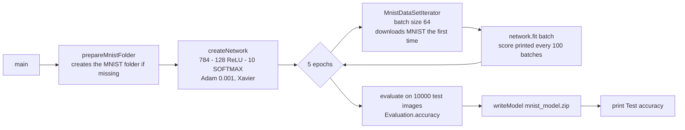

# Documentation notes

**Project:** MNIST Handwritten Digit Classifier
**Course:** PBCST304 - Object Oriented Programming (KTU S3)
**Stack:** Java 17+, Swing, Deeplearning4j 1.0.0-M2.1 (`nd4j-native-platform`), SQLite via JDBC

This file contains everything needed for the report and the viva:

* (a) class table + mermaid class diagram
* (b) database table with column datatypes
* (c) architecture / flow description + mermaid flowchart
* (d) list of OOP concepts and the class that shows each one
* (e) 8 sample test cases in the format `Id | Description | Expected output | Pass/Fail`

---

## (a) Class table and class diagram

### a.1 Class table

| # | Class / Interface | Package | Kind | Attributes | Key methods | Relationships |
|---|---|---|---|---|---|---|
| 1 | `DigitClassifier` | `model` | interface | - | `classify(double[]) : Prediction` (throws `PredictionException`) | implemented by `Dl4jDigitClassifier`; held by `MainFrame` |
| 2 | `Prediction` | `model` | class (model object) | `- digit : int`, `- confidence : double` | `Prediction(int, double)`, `getDigit()`, `getConfidence()` | returned by `DigitClassifier.classify()`; read by `MainFrame`; its values are written to the database |
| 3 | `Dl4jDigitClassifier` | `model` | class (implements interface) | `- network : MultiLayerNetwork`, `+ MODEL_FILE : String` | `loadFromDisk() : Dl4jDigitClassifier` (static factory), `classify(double[]) : Prediction` | implements `DigitClassifier`; creates `Prediction`; uses DL4J `MultiLayerNetwork` and `ModelSerializer` |
| 4 | `ModelTrainer` | `model` | class with `main()` | `- BATCH_SIZE`, `- EPOCHS`, `- LEARNING_RATE`, `- TEST_EXAMPLES`, `- MODEL_FILE`, `- DL4J_BASE_FOLDER : String` (constants) | `main(String[])`, `prepareMnistFolder()`, `createNetwork()`, `train(MultiLayerNetwork, int)`, `evaluate(MultiLayerNetwork)`, `saveModel(MultiLayerNetwork)` | produces the model file that `Dl4jDigitClassifier` loads; uses DL4J `MnistDataSetIterator` and `Evaluation` |
| 5 | `HistoryRecord` | `db` | class (model object) | `- id : int`, `- digit : int`, `- confidence : double`, `- createdAt : String` | `HistoryRecord(int, int, double, String)`, `getId()`, `getDigit()`, `getConfidence()`, `getCreatedAt()` | created by `DatabaseManager`; read by `HistoryPanel` and `TestCases` |
| 6 | `DatabaseManager` | `db` | class (Singleton) | `- instance : DatabaseManager` (static), `- connection : Connection`, `- insertStatement`, `- lastDigitsStatement`, `- allHistoryStatement : PreparedStatement` | `getInstance() : DatabaseManager` (static), `insertPrediction(int, double)`, `getLastDigits(int) : List<HistoryRecord>`, `getAllHistory() : List<HistoryRecord>`, `clearHistory()`, `getHistoryCount()`, `close()` | Singleton; creates `HistoryRecord`; used by `Main`, `MainFrame`, `HistoryPanel`, `TestCases` |
| 7 | `DrawingCanvas` | `ui` | class extends `JPanel` | `+ CANVAS_SIZE : int = 280`, `+ BRUSH_SIZE : int = 20`, `- image : BufferedImage`, `- drawingEnabled : boolean` | `paintComponent(Graphics)`, `drawStroke(int,int,int,int)`, `toImageCoordinate(int)`, `getScaleFactor()`, `clear()`, `getImage()`, `getNormalisedPixels()`, `isDrawingEnabled()`, `setDrawingEnabled(boolean)` | inheritance from `JPanel`; registers `CanvasMouseHandler`; delegates to `ImageProcessor` |
| 8 | `CanvasMouseHandler` | `ui` | class implements two listener interfaces | `- canvas : DrawingCanvas`, `- previousX : int`, `- previousY : int` | `mousePressed()`, `mouseDragged()`, `mouseReleased()`, `mouseClicked()`, `mouseEntered()`, `mouseExited()`, `mouseMoved()` | implements `MouseListener` and `MouseMotionListener`; association with `DrawingCanvas` (event delegation) |
| 9 | `PreviewPanel` | `ui` | class extends `JPanel` | `- previewImage : BufferedImage`, `- displaySize : int` | `PreviewPanel(int)`, `setPreviewImage(BufferedImage)`, `clearPreview()`, `paintComponent(Graphics)` | inheritance from `JPanel`; used by `MainFrame` |
| 10 | `HistoryPanel` | `ui` | class extends `JPanel` | `- databaseManager : DatabaseManager`, `- ownerWindow : Window`, `- recentLabel : JLabel`, `- toggleButton : JButton`, `- tableModel : DefaultTableModel`, `- historyTable : JTable`, `- tableScrollPane : JScrollPane`, `- tableArea : JPanel`, `- expanded : boolean` | `refresh()`, `loadRecentDigits()`, `loadFullTable()`, `setExpanded(boolean)`, `isExpanded()`, `getToggleButton()`, `getHistoryTable()` | inheritance from `JPanel`; association with `DatabaseManager` and `HistoryRecord`; used by `MainFrame` |
| 11 | `MainFrame` | `ui` | class extends `JFrame` plus three named inner listener classes | `- classifier : DigitClassifier` (interface type), `- databaseManager : DatabaseManager`, `- canvas : DrawingCanvas`, `- previewPanel : PreviewPanel`, `- resultLabel : JLabel`, `- predictButton`, `- clearButton : JButton`, `- historyPanel : HistoryPanel` | `MainFrame(DatabaseManager, DigitClassifier)`, `predictCurrentDrawing()`, `createSmallImage(double[])`, `isCanvasEmpty(double[])`, `showMessage(String)`; inner: `PredictListener`, `ClearListener`, `HistoryToggleListener` | inheritance from `JFrame`; composition of `DrawingCanvas`, `PreviewPanel`, `HistoryPanel`; association with `DigitClassifier` and `DatabaseManager` |
| 12 | `Main` | root | class with `main()` | - | `main(String[])` | creates `DatabaseManager`, `Dl4jDigitClassifier` and `MainFrame`; catches `PredictionException` |
| 13 | `ImageProcessor` | `util` | final utility class | - (no instance fields) | `downsample(BufferedImage) : double[]`, `toPixelArray(BufferedImage) : double[]` | used by `DrawingCanvas` and `MainFrame`; static methods only |
| 14 | `PredictionException` | `exception` | class extends `Exception` | `- serialVersionUID : long` | `PredictionException(String)`, `PredictionException(String, Throwable)` | thrown by `DigitClassifier`, `Dl4jDigitClassifier`, `DatabaseManager`; caught in `MainFrame` and `Main` |
| 15 | `TestCases` | root | class with `main()` | `- passedCount : int`, `- totalCount : int` (static) | `main(String[])`, eight test methods, `report(...)` | uses `DatabaseManager`, `Dl4jDigitClassifier`, `ImageProcessor`, `Prediction` |

Notation: `-` private, `+` public.

### a.2 Mermaid class diagram



---

## (b) Database table

Database file: `digits.db` (SQLite 3). It is created automatically on the first run, in the
project folder.

```sql
CREATE TABLE IF NOT EXISTS history (
    id              INTEGER PRIMARY KEY AUTOINCREMENT,
    predicted_digit INTEGER,
    confidence      REAL,
    created_at      TEXT
);
```

| Column | SQLite datatype | Java type in the code | Constraint | Description |
|---|---|---|---|---|
| `id` | INTEGER | `int` | PRIMARY KEY, AUTOINCREMENT | unique row number, filled by SQLite |
| `predicted_digit` | INTEGER | `int` | 0 - 9 by application logic | the digit the network recognised |
| `confidence` | REAL | `double` | 0.0 - 100.0 by application logic | confidence in percent, for example `98.6` |
| `created_at` | TEXT | `String` | format `yyyy-MM-dd HH:mm:ss` | local date and time of the prediction |

Operations implemented in `DatabaseManager` (all with `PreparedStatement`, all inside
`try`/`catch`, closing their `ResultSet` in `finally`):

| Method | SQL | Used by |
|---|---|---|
| `insertPrediction(int, double)` | `INSERT INTO history (predicted_digit, confidence, created_at) VALUES (?, ?, ?)` | the GUI after every prediction |
| `getLastDigits(int n)` | `SELECT ... ORDER BY id DESC LIMIT ?` | the `Recent:` strip |
| `getAllHistory()` | `SELECT ... ORDER BY id DESC` | the expandable `JTable` |
| `clearHistory()` | `DELETE FROM history` | test cases and the report only (no button) |
| `getHistoryCount()` | `SELECT COUNT(*) FROM history` | test cases |

Both read methods return `java.util.List<HistoryRecord>`, so no `ResultSet` ever leaves the `db`
package and the GUI cannot depend on the table structure.

---

## (c) Architecture and flow

### c.1 One-paragraph description

The program is split into five packages so that each concern lives in exactly one place. The `ui`
package builds one Swing window: `DrawingCanvas` collects the strokes through `CanvasMouseHandler`
(event delegation), `PreviewPanel` shows the 28x28 image, `HistoryPanel` shows the recent digits and
the full table, and `MainFrame` owns the buttons and runs the predict flow. When the user presses
Predict, `MainFrame` asks `DrawingCanvas` for the normalised pixels, which delegates the 280x280 to
28x28 averaging to `ImageProcessor.downsample()` in the `util` package. `MainFrame` holds that
classifier in a field of type `DigitClassifier` (the interface in the `model` package), so the call
`classifier.classify(pixels)` is polymorphic and is actually executed by `Dl4jDigitClassifier`, the
only class that knows Deeplearning4j. That object was created by `Main` with `loadFromDisk()`, which
restores `mnist_model.zip` - the file produced earlier by `ModelTrainer`, a separate console program
that lets DL4J download MNIST, trains 784-128-10 with Adam, prints the test accuracy and saves the
model. The returned `Prediction` object carries the digit and the confidence back to `MainFrame`,
which displays only those two values and then writes the row with
`DatabaseManager.insertPrediction()`. `DatabaseManager` is a Singleton that owns the single JDBC
connection to `digits.db` and turns rows into `HistoryRecord` objects; after the insert,
`HistoryPanel.refresh()` asks it for `getLastDigits(3)` and `getAllHistory()`, so the strip and the
table always show the database contents and never an in-memory copy. Every failure in this chain -
missing model, image the network cannot use, database error - is reported as the custom checked
exception `PredictionException`, which `MainFrame` turns into a message box. Dependencies always point
one way: `ui` uses `model`, `db` and `util`, while `model` and `db` never refer back to `ui`.

### c.2 Mermaid flowchart



### c.3 One prediction, step by step

1. `PredictListener.actionPerformed()` locks the canvas and the Predict button.
2. `DrawingCanvas.getNormalisedPixels()` -> `ImageProcessor.downsample()` -> `double[784]` in 0..1.
3. `MainFrame.createSmallImage()` builds the 28x28 preview from the same array, so the preview and
   the network input can never disagree.
4. `isCanvasEmpty()` stops an all-black canvas with a warning instead of guessing a digit.
5. `classifier.classify(pixels)` -> `Dl4jDigitClassifier` -> softmax -> `Prediction`.
6. The result label shows the digit and the confidence only.
7. `databaseManager.insertPrediction()` stores the row; `historyPanel.refresh()` reloads the strip
   and the table from the database.
8. `finally` unlocks the canvas and the button, whether the prediction succeeded or failed.

### c.4 Training flow (ModelTrainer, run once)



### c.5 Why the drawing area must stay a square (coordinate mapping)

The drawing is stored in a 280x280 `BufferedImage` inside `DrawingCanvas`, and every mouse position is
a position *on that picture*. If the canvas were stretched to a different shape by its layout, the
picture would still be painted stretched over the component, and the brush coordinates would no
longer line up with the pointer - the stroke would appear shifted or slanted.

Two small things prevent that:

1. `MainFrame` puts the canvas in a holder panel with `GridBagLayout` and a 10 px border, so the
   canvas keeps its preferred 280x280 square instead of being stretched by `BorderLayout.CENTER`.
2. `DrawingCanvas` maps component coordinates to picture coordinates anyway, with
   `toImageCoordinate()` and `getScaleFactor()`, and `drawStroke()` scales the `Graphics2D` by the
   same factor. On a normal display the factor is exactly 1.0, but on a scaled display the stroke
   still starts exactly under the pointer.

Measured in the running program: canvas 280x280 (square), scale factor 1.0, pointer (140, 40) maps
to picture (140, 40).

---

## (d) OOP concepts used, and where

| OOP concept | Where it is shown | Why it counts |
|---|---|---|
| **Encapsulation** | `Prediction`, `HistoryRecord`; also `DatabaseManager` | every field is `private` and `final`; values enter only through the constructor and leave only through getters, so an object cannot be modified or corrupted after creation. `DatabaseManager` hides its `Connection` and all `ResultSet` handling |
| **Abstraction** | `DigitClassifier` (interface) | the interface states *what* a classifier does (`classify`) and hides *how* (DL4J, tensors, softmax). `MainFrame` works only with this abstraction |
| **Inheritance** | `DrawingCanvas extends JPanel`, `PreviewPanel extends JPanel`, `HistoryPanel extends JPanel`, `MainFrame extends JFrame` | each class reuses all the Swing behaviour of its superclass and adds only what is specific to this program (painting, layout, window behaviour) |
| **Interface implementation** | `Dl4jDigitClassifier implements DigitClassifier`, `CanvasMouseHandler implements MouseListener, MouseMotionListener` | the class promises to provide every method of the interface; the mouse handler shows the same idea in the GUI layer as the classifier shows in the model layer |
| **Polymorphism (runtime)** | the field `MainFrame.classifier` | it is declared as `DigitClassifier` but refers to a `Dl4jDigitClassifier` object, so `classifier.classify(pixels)` runs the DL4J code. Another implementation of the interface could be substituted without changing any GUI code |
| **Polymorphism (compile-time / overloading)** | `PredictionException(String)` and `PredictionException(String, Throwable)` | the same method name with different parameter lists |
| **Event delegation model** | `CanvasMouseHandler` registered by `DrawingCanvas`; `PredictListener`, `ClearListener`, `HistoryToggleListener` inside `MainFrame` | Swing calls the listener object when the event happens; the event source and the handling code are separate classes, and every listener is a **named class** (no lambdas, no anonymous classes) - as required for this project |
| **Custom exception** | `PredictionException extends Exception` | a checked exception with a user-readable message; thrown for a missing model, an invalid pixel array, a network failure and every database failure, then caught in `MainFrame` and `Main`, where a dialog can be shown |
| **Exception handling with `finally`** | `PredictListener.actionPerformed()`, `DatabaseManager.createTable()`, `getLastDigits()`, `getAllHistory()`, `clearHistory()` | resources are always released and the canvas and buttons are always unlocked, even when an error happens |
| **Packages** | `model`, `db`, `ui`, `util`, `exception` | one responsibility per package, and the dependency direction is one-way: `ui` depends on `model`, `db` and `util`; `model` and `db` depend only on `util` and `exception`, never on `ui` |
| **Singleton pattern** | `DatabaseManager` | private constructor, one `static instance` field, `static synchronized getInstance()`; guarantees exactly one JDBC connection to `digits.db` for the whole program |
| **Utility class** | `ImageProcessor` | `final` class with a private constructor and only `static` methods, because downsampling needs no object state |
| **Composition / aggregation** | `MainFrame` owns `DrawingCanvas`, `PreviewPanel`, `HistoryPanel`, `DatabaseManager` and the `DigitClassifier` | the frame is assembled from parts; the parts are created and destroyed together with the frame |
| **Association** | `HistoryPanel` -> `DatabaseManager` -> `HistoryRecord`; `CanvasMouseHandler` -> `DrawingCanvas`; `MainFrame` -> `DigitClassifier` | "uses a" relationships between separate objects that both keep existing independently |
| **Data hiding across layers** | the `db` package returns `List<HistoryRecord>`, never a `ResultSet` | the SQL details stay inside `DatabaseManager`, so the GUI cannot depend on the table structure |
| **Static factory method** | `Dl4jDigitClassifier.loadFromDisk()` with a private constructor | forces every caller through the "model file exists and loads" check, so an invalid classifier object can never be created |

---

## (e) Sample test cases

Run all of them with:

```bash
mvn exec:java "-Dexec.mainClass=com.college.mnist.TestCases"
```

Test case 7 needs `mnist_model.zip` (run `ModelTrainer` once first); the others need no model. The
expected results below are the ones produced on the machine where the project was built, with a model
trained to about 97.4 % test accuracy.

| Id | Description | Expected output | Pass/Fail |
|---|---|---|---|
| TC-01 | Build a 280x280 image with a white 80x80 square, call `ImageProcessor.downsample()`, then check the array size, the value range and the middle value | 784 values, every value within 0.0 - 1.0, middle value about 1.000 | Pass |
| TC-02 | Create `new Prediction(7, 98.6)` and read both values back through the getters | `getDigit()` returns 7 and `getConfidence()` returns 98.6, unchanged | Pass |
| TC-03 | Call `DatabaseManager.getInstance()` twice and compare the two references | both references point to the same object (Singleton) | Pass |
| TC-04 | `clearHistory()`, insert digit 1 with 91.5 % and digit 3 with 88.0 %, then call `getLastDigits(2)` | 2 rows, newest first: first row digit 3, second row digit 1 | Pass |
| TC-05 | `clearHistory()`, then call `getLastDigits(3)` on the empty table and `getHistoryCount()` | empty list (0 rows), no exception thrown, count = 0 | Pass |
| TC-06 | Call `Dl4jDigitClassifier.loadFromDisk()` while `mnist_model.zip` is not present | `PredictionException` whose message contains "run ModelTrainer first" | Pass |
| TC-07 | Load the trained model, downsample a 280x280 image containing a thick vertical white stroke, and call `classify()` | a digit between 0 and 9 (1 for a plain vertical stroke) with confidence between 0 and 100 % | Pass |
| TC-08 | `clearHistory()`, insert one prediction, then `clearHistory()` again and read the count | count = 1 before the clear and count = 0 after it | Pass |

Sample console output of a real run:

```
=== MNIST Digit Classifier - test cases ===
Format: Id | Description | Expected output | Pass/Fail

TC-01 | ImageProcessor.downsample() on a 280x280 image with a white square | 784 values, all in 0..1, and a white block still present | PASS
      actual: 784 values, middle value 1.000
TC-02 | Prediction stores digit and confidence and returns them unchanged | digit = 7 and confidence = 98.6 | PASS
      actual: digit = 7, confidence = 98.6
TC-03 | DatabaseManager.getInstance() called twice returns one object | both references are the same object (singleton) | PASS
      actual: same instance
TC-04 | insertPrediction() then getLastDigits(2) | 2 rows, newest first: digit 3 then digit 1 | PASS
      actual: 2 rows, first digit 3, second digit 1
TC-05 | getLastDigits(3) on an empty table and getHistoryCount() | empty list, no exception, count = 0 | PASS
      actual: 0 rows, count = 0
TC-06 | Dl4jDigitClassifier.loadFromDisk() with no mnist_model.zip | PredictionException with the message 'run ModelTrainer' | PASS
      actual: PredictionException raised
TC-07 | Dl4jDigitClassifier.classify() on a simple drawn stroke | a digit 0..9 with confidence 0..100 % | PASS
      actual: digit 1, confidence 100.0 %
TC-08 | clearHistory() removes all rows inserted before | count = 0 after clearHistory() | PASS
      actual: count before = 1, after = 0

Summary: 8 of 8 test cases passed.
```

Notes for the report:

* TC-01 proves the hand-written 10x10 block averaging and the 0..1 normalisation, which is the same
  scaling DL4J's MNIST reader uses for training.
* TC-02 proves encapsulation (the values cannot change after construction).
* TC-03 proves the Singleton pattern.
* TC-04 and TC-05 prove `insertPrediction()`, `getLastDigits()` and the empty-table case.
* TC-06 proves the custom exception and the missing-model message. When `mnist_model.zip` already
  exists the case reports the model as present instead of failing, so the suite stays green.
* TC-07 proves the whole prediction path end to end (interface -> DL4J -> `Prediction`).
* TC-08 proves `clearHistory()`, the delete operation of CRUD that deliberately has no GUI button.

### Model accuracy measured during development

| Run | Epochs | Test accuracy | Time |
|---|---|---|---|
| Quick check | 1 | 94.11 % | about 13 s |
| Final model used by the app | 5 | 97.36 % | about 22 s |

(CPU only, `nd4j-native-platform` backend, batch size 64, Adam with learning rate 0.001.)
